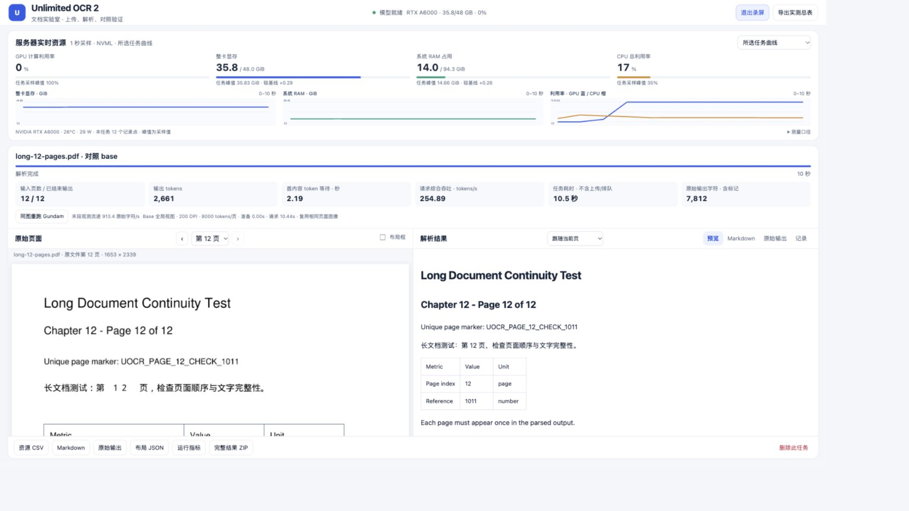

# Unlimited OCR 2 Cloud Deploy Skill

把百度 Unlimited OCR 2 部署到云 GPU，并提供可在浏览器中实测的文档工作台。这个 skill 来自一次实际跑通的 Ubuntu 22.04 + RTX A6000 48GB 部署，保存了完整依赖、定制 SGLang、CUDA 编译环境、HTTPS、资源监控及排障流程。

## 包含什么

- 可安装的 `SKILL.md`、Codex 元数据与按需读取的部署/运维/验收参考。
- 可复制的部署源码：FastAPI Web UI、PDF/图片输入、原图连续滚动翻页与当前页结果联动、布局框、Markdown/原始结果和 ZIP 下载。
- 视频工具：GPU/显存/RAM/CPU 的每秒采样、曲线和峰值，录屏模式，同输入 Base/Gundam 对照，人工参考文本 CER 与 CSV 导出。
- 已锁定的 212 个 Python 包、百度定制 SGLang wheel、CUDA 13 编译工具配置、systemd 与认证 HTTPS 安装脚本。
- 模型固定快照下载/权重校验、原创单页/3 页/12 页样本生成、安全排空升级和验收脚本。



## 安装 skill

```bash
git clone https://github.com/win4r/unlimited-ocr2-cloud-deploy.git
cd unlimited-ocr2-cloud-deploy
SKILL_PARENT="${CODEX_HOME:-$HOME/.codex}/skills"
mkdir -p "$SKILL_PARENT"
if [ -e "$SKILL_PARENT/unlimited-ocr2-cloud-deploy" ]; then
  echo '已有同名 skill；请先检查并备份，再决定更新。'
else
  cp -R skills/unlimited-ocr2-cloud-deploy "$SKILL_PARENT/"
fi
```

在新的 Codex 会话中使用：

```text
使用 $unlimited-ocr2-cloud-deploy，将 Unlimited OCR 2 部署到我授权的云 GPU，
配置浏览器测试台、GPU/RAM 监控，并保留本地复用备份。
```

SSH 信息在自己的会话中提供，不要写入 GitHub issue、仓库或 skill。其它支持目录式 `SKILL.md` 的代理可以使用同一 skill，工具可用性与授权仍以运行环境为准。

## 手动复用部署源码

```bash
python3 skills/unlimited-ocr2-cloud-deploy/scripts/prepare_deployment.py \
  --output ./unlimited-ocr2
# 接着按下面的部署说明上传到 GPU 主机并安装
```

完整步骤：[部署与依赖](skills/unlimited-ocr2-cloud-deploy/references/deployment.md) · [服务管理、升级与排障](skills/unlimited-ocr2-cloud-deploy/references/operations.md) · [验收与测量口径](skills/unlimited-ocr2-cloud-deploy/references/verification.md) · [原实测环境与边界](skills/unlimited-ocr2-cloud-deploy/references/tested-setup.md)。

## 适用范围

已验证路径是 Ubuntu 22.04 x86_64、RTX A6000 48GB、现有兼容 CUDA 13 的驱动与 Python 3.11。48GB 不是最低硬件要求；其它硬件和系统需重新验收。不要混用 stock SGLang、原生 Transformers 示例环境或随意改成 `latest`。首次安装入口面向专用主机，已有代理/部署时会停止，避免覆盖其它配置。

仓库检查验证 skill 结构、源码语法、依赖/静态资源校验和、准备目录保护和 smoke-test 失败条件；不运行 GPU 推理、不下载权重。原部署做过真实推理，新目标仍需执行 GPU 验收。资源峰值包含服务预留池，CER 不代表表格结构或公式语义准确率。

本仓库不包含模型权重、SSH/Web 密码、原服务器地址、用户上传文档、任务历史或私有运行目录。权重在部署时从固定 HF 快照下载。

## 来源与许可

[官方模型](https://huggingface.co/baidu/Unlimited-OCR-2) · [百度官方代码](https://github.com/baidu/Unlimited-OCR)。新增代码/文档采用 [MIT](LICENSE)，定制 wheel、后处理与 KaTeX 保留各自许可，见 [THIRD_PARTY.md](THIRD_PARTY.md)。本项目是独立部署封装，不是百度官方发布。
